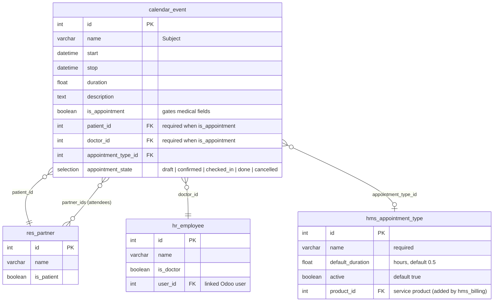
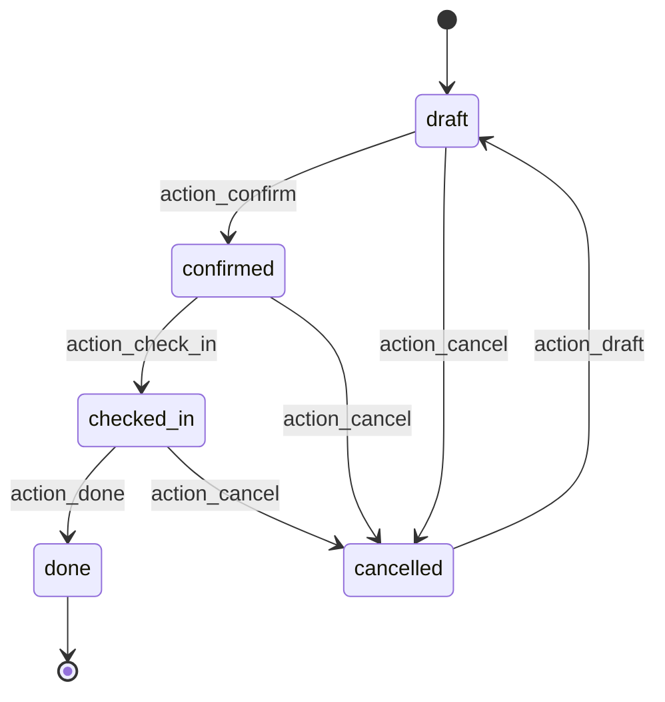

# hms_appointment — Entity Relationship Diagram

## Relationships

| From | To | Type | Field | Description |
|:-----|:---|:-----|:------|:------------|
| `calendar.event` | `res.partner` | Many2one | `patient_id` | The patient this appointment is for (required when `is_appointment=True`) |
| `calendar.event` | `hr.employee` | Many2one | `doctor_id` | The doctor conducting the appointment (required when `is_appointment=True`) |
| `calendar.event` | `hms.appointment.type` | Many2one | `appointment_type_id` | Pre-fills default duration via onchange |
| `calendar.event` | `res.partner` | Many2many | `partner_ids` | Calendar attendees — patient and doctor's user partner are auto-synced here on create/write |

## State machine

## Notes

- `calendar.event` is an **inherited** Odoo CE model — only the fields added by `hms_appointment` are shown. Core fields (`start`, `stop`, `duration`, `partner_ids`, etc.) exist in the base `calendar` module.
- `res.partner` and `hr.employee` are shown with the subset of fields relevant to appointments; see [hms_base ERD](/developer/erd/base) for their full `hms_base` extensions.
- The `is_appointment` boolean isolates medical appointments from regular calendar meetings. Dedicated views filter on `is_appointment=True`.
- Attendee sync: on create/write, `patient_id` and `doctor_id.user_id.partner_id` are auto-added to `partner_ids` so doctors see appointments in their native Odoo/mobile calendar.
- `hms_appointment_type.product_id` is not yet present — it will be wired by `hms_billing` in Phase 4.
