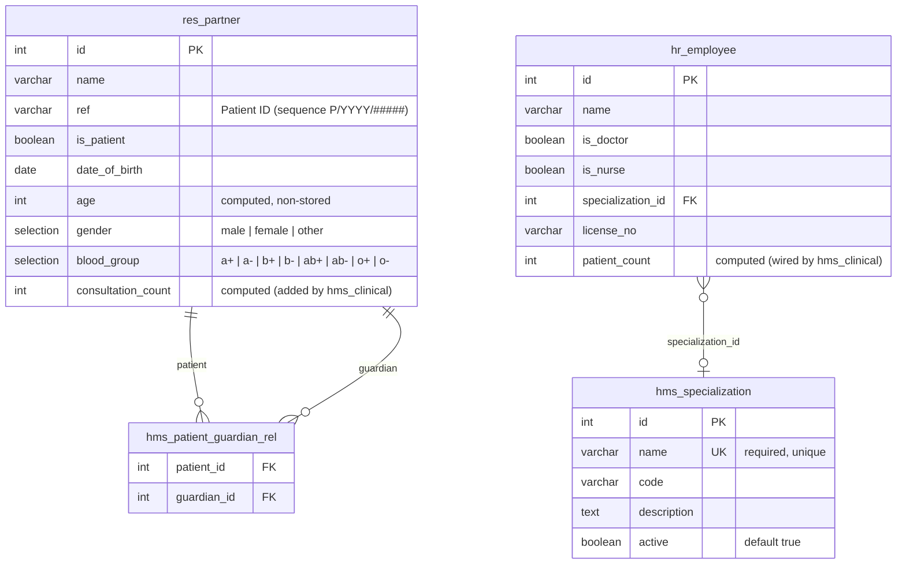

# hms_base — Entity Relationship Diagram

## Relationships

| From | To | Type | Field | Description |
|:-----|:---|:-----|:------|:------------|
| `hr.employee` | `hms.specialization` | Many2one | `specialization_id` | A doctor/nurse's medical specialty |
| `res.partner` | `res.partner` | Many2many (self) | `guardian_ids` | Links a patient to their guardian(s) via `hms_patient_guardian_rel` |

## Notes

- `res.partner` and `hr.employee` are **inherited** Odoo CE models — the fields shown above are only the ones added by `hms_base`. Core fields (`name`, `email`, `phone`, etc.) are omitted.
- `age` is a non-stored computed field (`@api.depends("date_of_birth")`); it never goes stale.
- `patient_count` on `hr.employee` is defined here as a placeholder; `hms_clinical` overrides the compute to count distinct patients from `hms.consultation`.
- `consultation_count` on `res.partner` is added by `hms_clinical` (not present until that module is installed).
- The native `res.partner.ref` field is reused for patient identifiers, populated from the `hms.patient.ref` sequence on create when `is_patient=True`.
