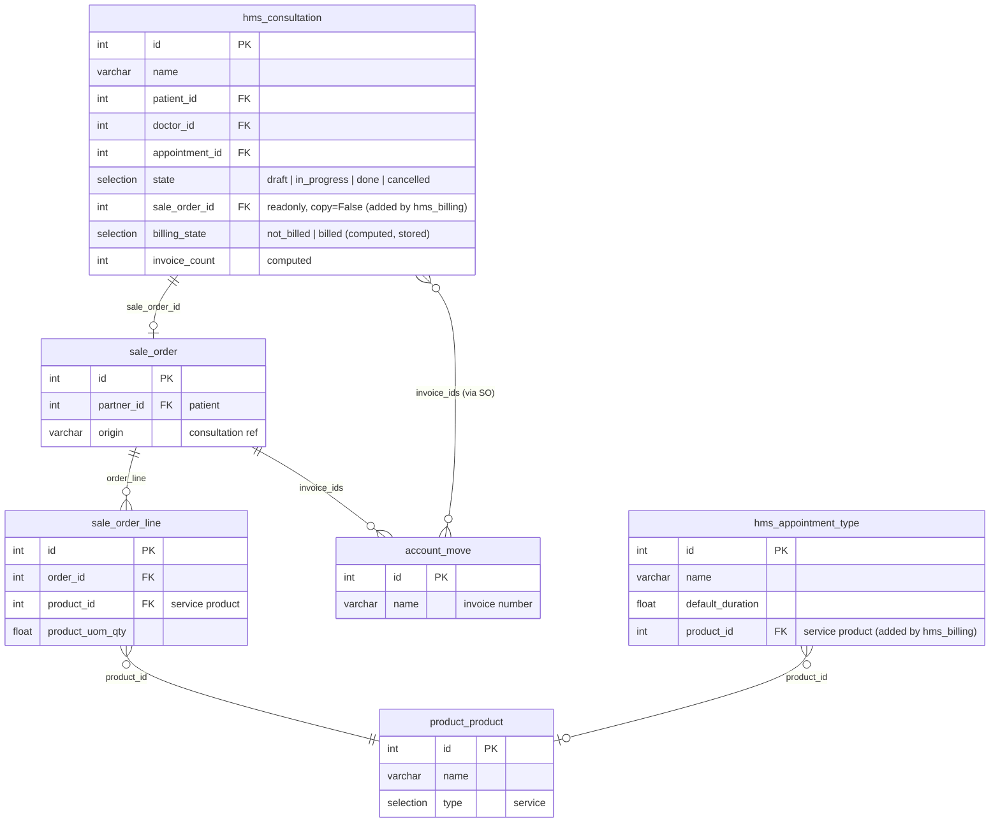
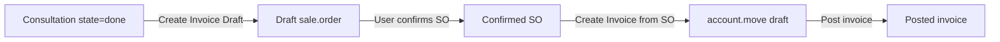

# hms_billing — Entity Relationship Diagram

## Billing workflow

## Relationships

| From | To | Type | Field | Description |
|:-----|:---|:-----|:------|:------------|
| `hms.consultation` | `sale.order` | Many2one | `sale_order_id` | The draft SO created for this consultation |
| `hms.consultation` | `account.move` | Many2many | `invoice_ids` | Computed from `sale_order_id.invoice_ids` |
| `sale.order` | `res.partner` | Many2one | `partner_id` | The patient being billed |
| `sale.order.line` | `product.product` | Many2one | `product_id` | The billing product (service) |
| `hms.appointment.type` | `product.product` | Many2one | `product_id` | The default billing product for this type |

## Notes

- `sale.order`, `sale.order.line`, and `account.move` are stock Odoo CE models — not created by this module, only referenced.
- `hms.consultation` and `hms.appointment.type` fields shown here are only those **added by `hms_billing`**; see [hms_clinical ERD](/developer/erd/clinical) and [hms_appointment ERD](/developer/erd/appointment) for their full field lists.
- The billing flow is manual: `action_create_sale_order` creates a draft SO, but the user must confirm the SO and create/post the invoice via standard Odoo workflows.
