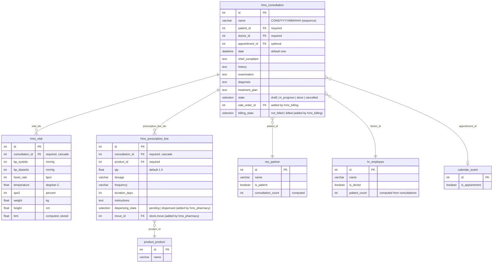
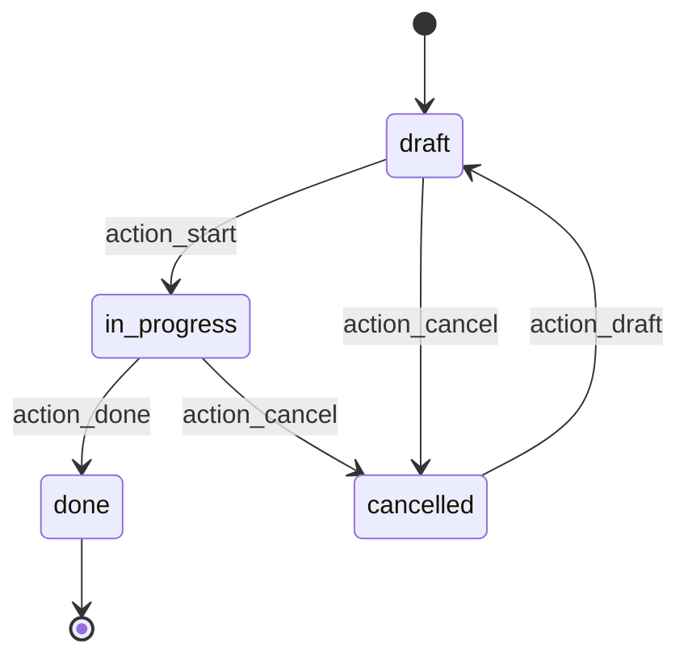

# hms_clinical — Entity Relationship Diagram

## Relationships

| From | To | Type | Field | Description |
|:-----|:---|:-----|:------|:------------|
| `hms.consultation` | `res.partner` | Many2one | `patient_id` | The patient (required) |
| `hms.consultation` | `hr.employee` | Many2one | `doctor_id` | The attending doctor (required, defaults to current user's employee) |
| `hms.consultation` | `calendar.event` | Many2one | `appointment_id` | Optional link to the originating appointment |
| `hms.consultation` | `hms.vital` | One2many | `vital_ids` | Vital signs recorded during this consultation |
| `hms.consultation` | `hms.prescription.line` | One2many | `prescription_line_ids` | Medications prescribed |
| `hms.prescription.line` | `product.product` | Many2one | `product_id` | The medicine / product prescribed |
| `res.partner` | `hms.consultation` | One2many | `consultation_ids` | All consultations for this patient (inverse of `patient_id`) |

## State machine

## Record rules (hms.consultation)

| Rule | Group | Read | Write | Create | Unlink | Domain |
|:-----|:------|:----:|:-----:|:------:|:------:|:-------|
| Read all | `group_hms_user` | Y | - | - | - | `[(1,'=',1)]` |
| Write own | `group_hms_user` | - | Y | Y | - | `[('doctor_id.user_id','=',user.id)]` |
| No unlink | `group_hms_user` | - | - | - | Y | `[(0,'=',1)]` (always false) |
| Full access | `group_hms_manager` | Y | Y | Y | Y | `[(1,'=',1)]` |

## Notes

- `hms.consultation` inherits `mail.thread` and `mail.activity.mixin` for chatter and activity tracking.
- `hms.vital.bmi` is a stored computed field (`weight / (height_m^2)`); returns 0 when weight or height is missing.
- `hms.prescription.line` references `product.product` but creates no stock moves — stock integration is deferred to `hms_pharmacy`.
- `res.partner` and `hr.employee` are shown with only the fields added/extended by `hms_clinical`; see [hms_base ERD](/developer/erd/base) for their full `hms_base` extensions.
