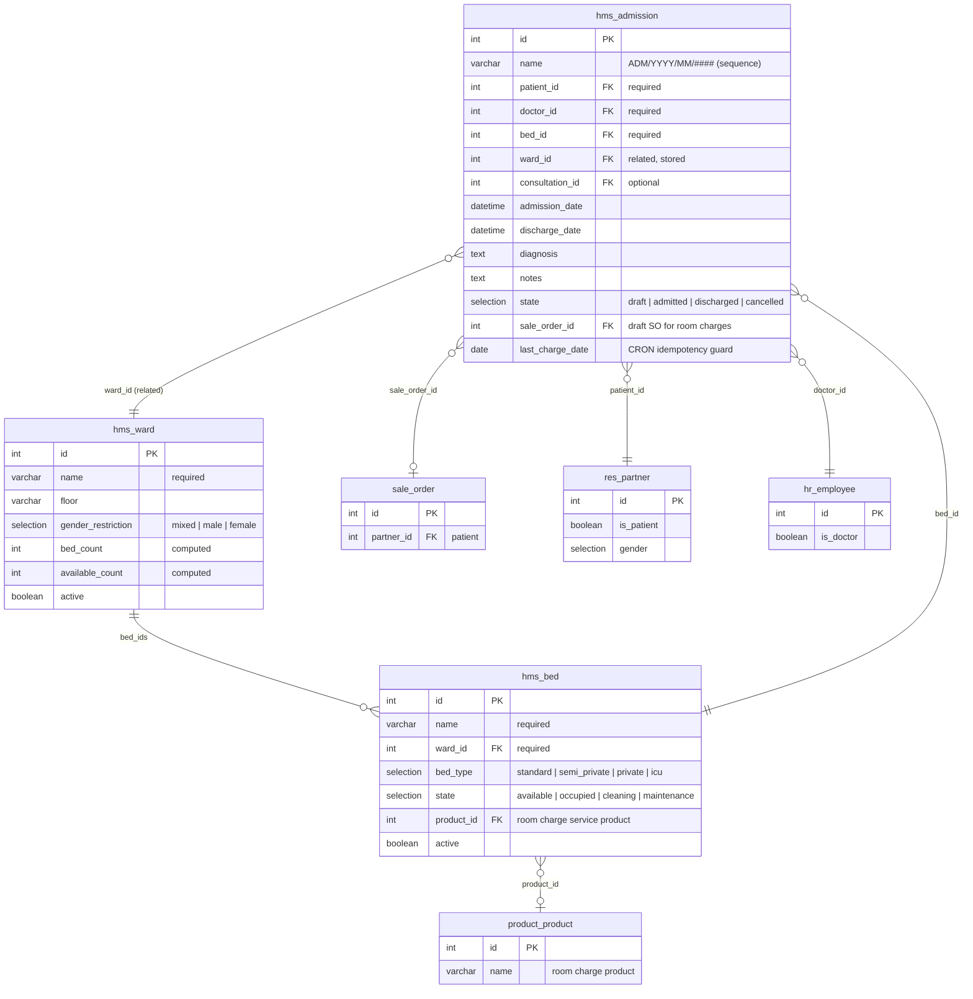
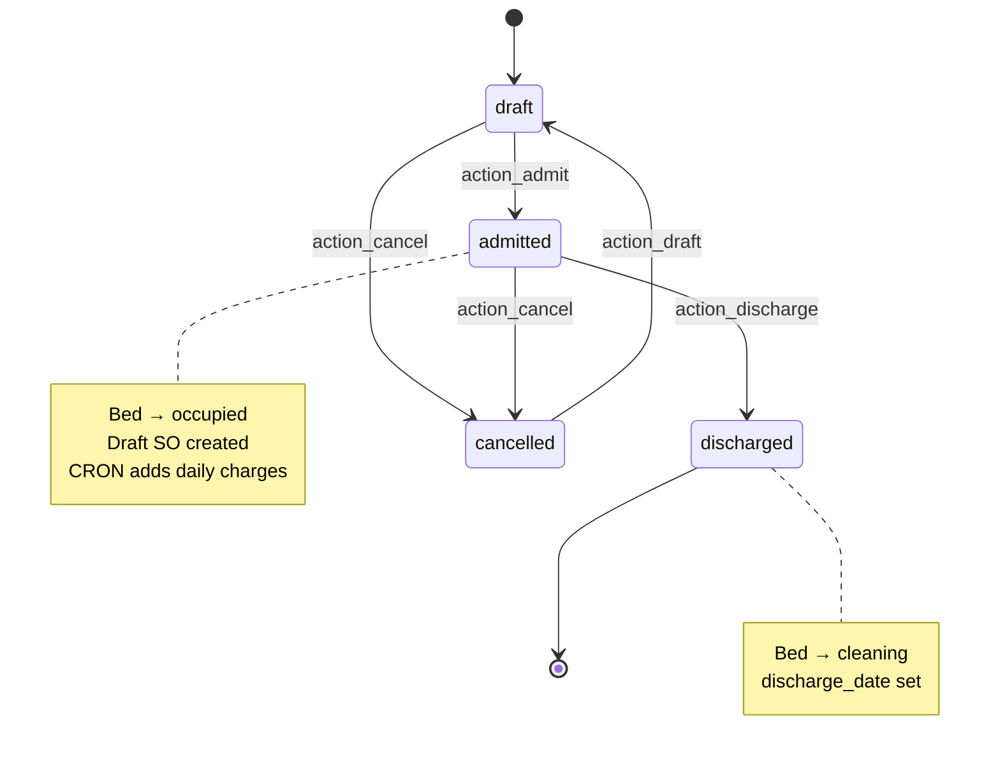
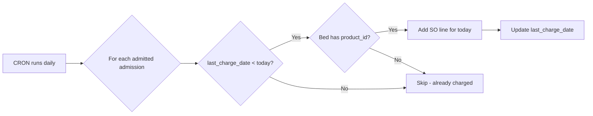

# hms_inpatient — Entity Relationship Diagram

## Admission workflow

## Daily room-charge CRON

## Safety checks

- **Bed availability:** `action_admit` raises if bed state != `available`.
- **Gender restriction:** `action_admit` raises if patient gender doesn't match ward's `gender_restriction` (unless `mixed`).
- **CRON idempotency:** `last_charge_date` guard prevents duplicate charges if the CRON runs twice.

## Notes

- `sale.order`, `product.product`, `res.partner`, `hr.employee` are stock Odoo CE models; only fields relevant to inpatient are shown.
- Doctor visit fees are handled outside this module: create a consultation (hms_clinical) + bill it (hms_billing). No per-visit automation in hms_inpatient.
- Bed transfers mid-admission are not supported — discharge and re-admit to a new bed.
