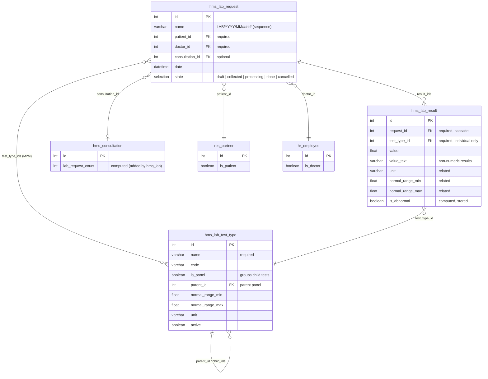
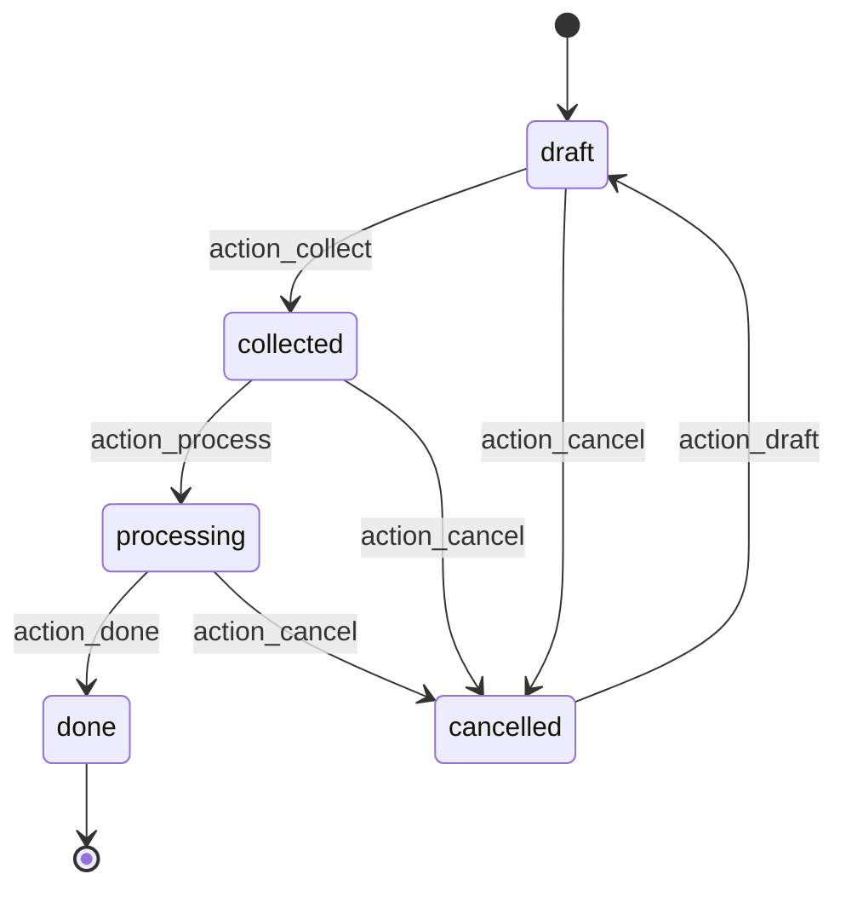
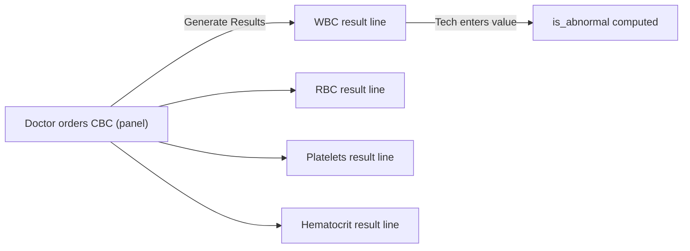

# hms_lab — Entity Relationship Diagram

## Request workflow

## Panel expansion

## Notes

- `hms.lab.test.type` is self-referential: panels (`is_panel=True`) have `child_ids`; individual tests may have a `parent_id`.
- `action_generate_results` is state-gated to draft/collected only. It expands panels and skips duplicates.
- `is_abnormal` is a stored compute: True when `value` falls outside `[normal_range_min, normal_range_max]`. Qualitative results (`value_text`) require manual toggle.
- `hms.lab.result` records cascade-delete with their parent `hms.lab.request`.
