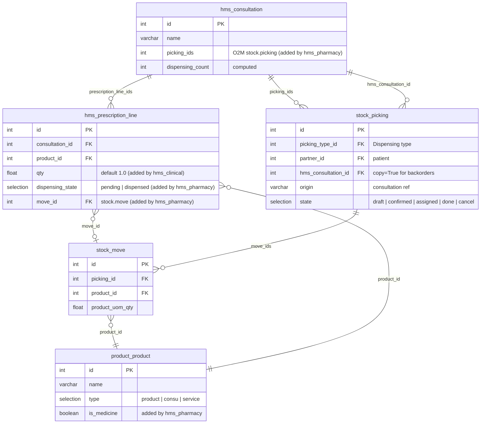
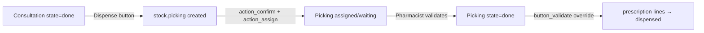

# hms_pharmacy — Entity Relationship Diagram

## Dispensing workflow

## Notes

- `stock.picking`, `stock.move`, and `product.product` are stock Odoo CE models — only fields added by `hms_pharmacy` are shown.
- `hms_consultation_id` on `stock.picking` uses `copy=True` so backorder pickings retain the consultation link.
- The Pharmacy stock location uses FEFO removal strategy (via `product_expiry`) to consume nearest-expiry lots first.
- `hms.prescription.line.qty` is defined in `hms_clinical` (default 1.0) and used by `hms_pharmacy` for `product_uom_qty` on stock moves.
- Service products are skipped during dispensing — only storable (`product`) and consumable (`consu`) products generate stock moves.
